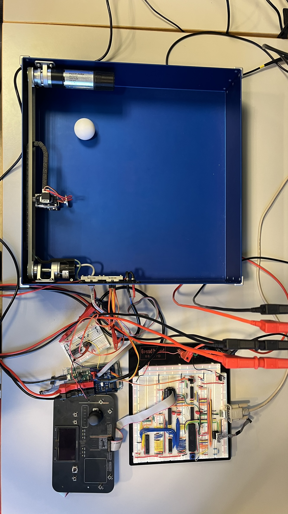

# TTK4155 - Distributed Embedded Ping-Pong System

An industrial-grade, distributed embedded game system developed for the TTK4155 course (*Industrial and Embedded Computer System Design*) at NTNU. The system implements a real-time, two-node interactive Ping-Pong arcade game featuring closed-loop motor control, IR goal detection, OLED menu navigation, dynamic paddle actuation, and high-speed CAN bus communication.

## 📌 System Overview

The system is designed around a distributed architecture split across two distinct microcontrollers:

1. **Node 1 (ATmega162 - 8-bit AVR):** Handheld Human-Machine Interface (HMI) controller on a breadboard. Handles analog input sampling (joystick/sliders), button interfacing, OLED UI execution, and external SRAM memory decoding.

2. **Node 2 (ATSAM3X8E - 32-bit ARM Cortex-M3 / Arduino Due):** Physical game enclosure controller. Manages real-time physical actuation (DC motor paddle positioning with quadrature encoder feedback, servo angle control, solenoid striker) and goal sensing via an IR beam breaker.

3. **CAN Bus Interface:** Multi-master differential bus connecting Node 1 (via SPI-driven MCP2515 CAN controller + MCP2551 transceiver) and Node 2 (via internal native CAN0 controller + MCP2562 transceiver).

## 🖼️ Physical Hardware Setup


*Figure 1: Full hardware setup showing Node 1 (ATmega162 breadboard & User I/O panel with OLED display) connected over the CAN bus to Node 2 (Arduino Due + Custom Motor Shield) controlling the physical ping-pong game box.*

## 🏗️ System Architecture & UML Class Diagram

The software stack follows a strict hierarchical design pattern, isolating hardware registers behind drivers and providing clean interfaces to high-level application logic.


*Figure 2: Complete UML Class Diagram displaying the layered structure of Node 1 and Node 2, functional color coding, and the central CAN bus connection.*

### Color Legend:

* 🔴 **Red / Pink (User Interface & Main Menu):** `menu.c`, `Oled.c`
* 🟢 **Green (Sensors & Analog Inputs):** `io_board.c`, `Analogs.c`, `ADC.c`, `encoder.c`, `ir.c`, `adc.c`
* 🔵 **Blue (Communications & Bus Drivers):** `CAN.c`, `MCP2515.c`, `SPI.c`, `UART.c`, `can.c`, `uart.c`
* 🟠 **Orange (Actuators & PWM Control):** `motor.c`, `solenoid.c`, `Servo.c`, `pwm.c`
* 🟣 **Purple (Hardware Core, Memory & Timing):** `XMEM.c`, `fonts.h`, `time.c`, `Timer0_Init`, `sam_library`

## 🧩 Hardware & Software Breakdown

### 🎮 Node 1 (ATmega162 - Master Controller)

Node 1 reads user controls and updates the physical display UI.

* **Drivers:**
  * `ADC.c`: Interfacing with the MAX156 ADC to read analog voltages ($0\text{V} - 5\text{V}$) from joystick and slider potentiometers.
  * `SPI.c`: Master SPI driver used by the MCP2515 CAN controller and User I/O peripheral board.
  * `MCP2515.c`: Driver for the external CAN controller chip over SPI.
  * `UART.c`: RS-232 serial interface for debugging and terminal stdout output.
  * `XMEM.c`: External memory interface configuring address decoding for multiplexed SRAM.

* **Libraries & Application:**
  * `menu.c`: State machine running the main game loop, high scores, and dynamic OLED menu screen.
  * `Oled.c` & `fonts.h`: Graphic and text renderer for the $128 \times 64$ OLED display over SPI.
  * `Analogs.c` & `io_board.c`: Logic for normalizing raw ADC input data into direction vectors and reading button states.
  * `CAN.c`: Message framing, transmission, and reception for Node 1.

### 🏓 Node 2 (ATSAM3X8E - Game Box Actuator)

Node 2 executes all real-time closed-loop control and physical hardware interaction.

* **Drivers:**
  * `can.c`: Utilizes native ATSAM3X8E CAN0 peripheral registers for low-latency network messaging.
  * `pwm.c`: Configures hardware PWM channels (e.g., $50\text{ Hz}$ servo control signal).
  * `adc.c`: Samples the analog signal from the IR optical transistor to detect goal events.
  * `ir.c`: Threshold detection and filtering logic for goal scoring.
  * `uart.c`: Serial communication for terminal reporting.

* **Libraries & Control Systems:**
  * `motor.c` & `encoder.c`: Closed-loop position/velocity control (PI/PID controller) for the motorized paddle, utilizing hardware Quadrature Decoder (TC2 channel 0).
  * `Servo.c`: Maps positional input ($0\% - 100\%$) to precise PWM pulse widths ($0.9\text{ ms} - 2.1\text{ ms}$) to drive the steering servo.
  * `solenoid.c`: Pulses a GPIO pin to trigger a Darlington transistor/relay, driving the electro-mechanical ball pin plunger.
  * `time.c` & `sam_library`: Low-level timing utilities and CMSIS hardware header access (`sam.h`).

## 📡 Information & Signal Flow

```
[ Human Input ] 
      │ (Joystick / Buttons)
      ▼
[ Node 1: IO Board ] ──(Analog / SPI)──► [ ATmega162 ]
                                                │
                                       (SPI to MCP2515)
                                                ▼
                                    [ MCP2551 Transceiver ]
                                                │
                                   (CAN_H / CAN_L Differential Bus)
                                                │
                                    [ MCP2562 Transceiver ]
                                                ▼
[ Game Board Hardware ] ◄──(PWM / GPIO)── [ Node 2: ATSAM3X8E ]
(Motor, Servo, Solenoid)                        │
      │                                         │
      └────────────(IR Beam Break ADC)──────────┘
```

1. **User Action:** Joy-stick movement on the User I/O board updates analog voltages.
2. **Sampling & Dispatch:** Node 1 samples voltages via `ADC.c`, maps direction vectors in `Analogs.c`, packages a CAN frame in `CAN.c`, and transmits it over SPI to `MCP2515.c`.
3. **Bus Transport:** The differential CAN bus transmits the data packet safely across the physical network cabling.
4. **Actuation & Response:** Node 2 receives the frame in `can.c`, updates motor velocity via `motor.c` (PID controller), shifts the steering servo angle via `Servo.c`, or fires the solenoid via `solenoid.c`.
5. **Score Loop:** If the ball crosses the goal line, `ir.c` detects the beam interrupt via `adc.c` and broadcasts a goal message over CAN back to Node 1 to update the OLED game score.

## 🛠️ Build & Flashing Instructions

### Prerequisites

* **Node 1 (AVR):** `avr-gcc`, `avr-libc`, `avrdude` or Microchip Studio.
* **Node 2 (ARM):** `gcc-arm-none-eabi`, `openocd` or `bossac`.

### Building Node 1 (ATmega162)

```bash
cd Node1
make clean
make
make flash
```

### Building Node 2 (ATSAM3X8E / Arduino Due)

```bash
cd Node2
make clean
make
make flash   # or bossac --port=ttyACM0 -e -w -v -b build/node2.bin -R
```

## 📜 License & Acknowledgments

Developed as part of **TTK4155 Industrial and Embedded Computer System Design** at the Norwegian University of Science and Technology (NTNU).